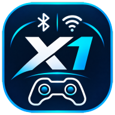
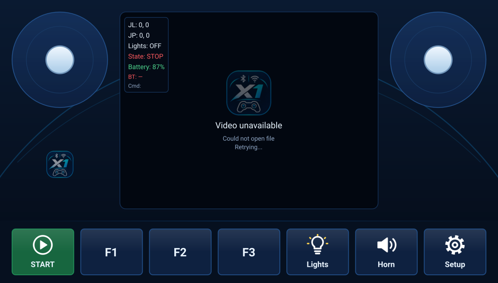

<p align="center">
  
</p>

# X1

An Android tablet app for controlling RC models (car, boat, drone).
Commands go to the model over Bluetooth Low Energy (BLE UART). The middle of the
screen shows the model's camera feed, streamed over RTSP.

Written in Qt 6 / QML (C++17). It targets Android (tested on a Lenovo TB-X606F
tablet with Android 10) and can also be built as a desktop app.



## Features

- **Two joysticks** that work at the same time, one finger each: left (JL) and right (JP).
- **START / STOP** – toggles the running state. STOP centres both joysticks.
- **F1, F2, F3** – momentary buttons (active only while held).
- **Lights** – toggle (on/off).
- **Horn** – active while held.
- **Live video** from the model's camera (RTSP, H.264). If the stream drops,
  the app tries to reconnect every 3 s.
- **Telemetry** overlaid on the video: joystick positions, state, lights,
  Bluetooth connection, last command sent.
- **Setup** – scan for and connect to a BLE module, RTSP stream address
  (remembered between runs).
- Dark navy and cyan theme that stays easy on the eyes at night.
- On Android the screen is locked to landscape.

## Bluetooth protocol

The app connects to a BLE UART module:

| Module | Service | Write characteristic |
|---|---|---|
| Nordic UART Service (e.g. ESP32, nRF) | `6e400001-b5a3-f393-e0a9-e50e24dcca9e` | `6e400002-…` (RX) |
| HM-10 / HM-19 / AT-09 | `0000ffe0-0000-1000-8000-00805f9b34fb` | `0000ffe1-…` |

Each command is a line of text ending in `\n`, sent in 20-byte chunks.

| Command | When |
|---|---|
| `JL:x,y` | left joystick moves, `x` and `y` from -100 to 100 (up = `+y`) |
| `JP:x,y` | right joystick moves, same as above |
| `START` / `STOP` | running state toggled |
| `F1_ON` / `F1_OFF` | F1 pressed / released (same for `F2`, `F3`) |
| `LIGHT_ON` / `LIGHT_OFF` | lights toggled |
| `HORN_ON` / `HORN_OFF` | horn pressed / released |

Joystick positions are sent at most every 50 ms, and only when they change.
After (re)connecting, the app immediately sends the lights state, START/STOP
and the joystick positions.

## Video (RTSP)

Enter the stream address in **Setup → Video (RTSP) → Apply**, for example:

```
rtsp://192.168.1.50:8554/stream
```

Video is played by Qt Multimedia (FFmpeg backend), so any RTSP stream with H.264
works: an IP camera, MediaMTX, GStreamer, and so on.

For testing without a model there is a simple Python RTSP server that streams the
computer's camera or a test pattern: [rtsp_server/](rtsp_server/README.md).

## Building

Requirements:

- Qt 6.8 or newer with the **Qt Quick**, **Qt Svg**, **Qt Bluetooth** and **Qt Multimedia** modules
- CMake 3.16+ and Ninja (installed with Qt)
- Android: Android SDK and NDK, **JDK 17**, Qt for Android (`arm64-v8a`)

The easiest way is to open `CMakeLists.txt` in Qt Creator and pick an Android or Desktop kit.

From the command line (PowerShell, Android, example paths):

```powershell
$env:JAVA_HOME = "C:\Program Files\Microsoft\jdk-17.0.21.21-hotspot"
C:\Qt\6.8.3\android_arm64_v8a\bin\qt-cmake.bat -S . -B build-android -G Ninja `
    -DCMAKE_BUILD_TYPE=Debug `
    -DANDROID_SDK_ROOT=$env:LOCALAPPDATA\Android\Sdk `
    -DQT_HOST_PATH=C:\Qt\6.8.3\mingw_64
cmake --build build-android --target apk
adb install -r build-android\android-build\build\outputs\apk\debug\android-build-debug.apk
```

Notes:

- `android/` holds only the manifest and the icons. Qt supplies the Gradle files
  for the version you build with.
- Ninja does not notice new files in `android/res`. After adding resources, delete
  `build-android/android-build/appX1.apk` so the APK is rebuilt.
- On Android the app asks for Bluetooth permission on first start (and for location
  on Android 11 and older, where BLE scanning does not work without it).

## Project layout

| File / folder | Contents |
|---|---|
| `main.cpp` | app start-up, landscape lock on Android |
| `blelink.h`, `blelink.cpp` | `BleLink` – scanning, connecting and sending commands over BLE UART |
| `Main.qml` | main screen: joysticks, video with telemetry, button bar |
| `Joystick.qml` | multi-touch joystick |
| `VideoView.qml` | RTSP player with automatic reconnect |
| `SetupDialog.qml` | settings dialog: Bluetooth and RTSP address |
| `Theme.qml` | app colour palette (taken from the icon) |
| `icons/` | button icons (SVG), logo and source artwork for the app icon |
| `android/` | manifest and app icon |
| `rtsp_server/` | Python RTSP test server |
